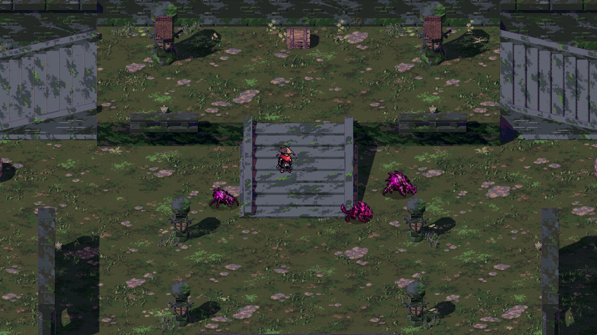

# Référence sprites et décor — Cour des Veilleurs



Scène de contrôle dérivée de la véritable partie `DraftRun`, mêmes lumières/caméra et rendu pixel actif.
Combat arrêté après initialisation ; HUD masqué ; les acteurs sont mis en pose sur la navigation.
Le Chasseur est sur les marches, skitterling, lunger et husk sur le sol ; murs, escaliers et piliers sont visibles.
Les sprites et leurs échelles restent ceux du jeu.

## Reproduire

```powershell
godot --path . --resolution 1600x900 res://tools/art/cour_reference.tscn -- --chapter=1 --bot --passive --god --seed=241115 --pixel=1 --reference-out=<dossier>
```

Le dossier reçoit une image PNG native et un JSON de contrôle. Dans le dépôt, seuls les WebP sans perte de
1600 px au plus sont retenus. [Avant calibration](avant.webp), [comparaison](comparaison.webp),
[paramètres de référence](reference.json), [contrôle des collisions et de la navigation](geometry.json).
Le comparatif découpe le même cadre sans redimensionner les pixels écran.

## Réglages retenus pour validation

- Gris froids/neutres sur les volumes de pierre pour les distinguer de la mousse du sol.
- Marches un peu plus claires que les piliers, qui gardent leurs zones de lichen.
- Trois gris réservés dans la palette finale de 32 couleurs ; tous les verts et le fond bleu nuit conservés.
- Échelle et détails inchangés : texel décor 0,025 m, pixel d'art du Chasseur 0,02405 m,
  grille du rendu 0,024038 m à cette taille de vue.
- Aucune modification de shader, de lumière, de géométrie, de collision, de règle ou d'Écho.

Vérifications natives Godot 4.3 / OpenGL Intel Iris Xe : chargement et capture sans erreur, sept tests
`test_pixel_render` réussis, lint ciblé conforme. Les 532 collisions, 551 placements de modules et 885 polygones
de navigation restent identiques. Le résultat doit encore être validé artistiquement par le propriétaire,
puis observé en combat et avec une horde : ce cadrage figé ne constitue pas un test de fluidité.
